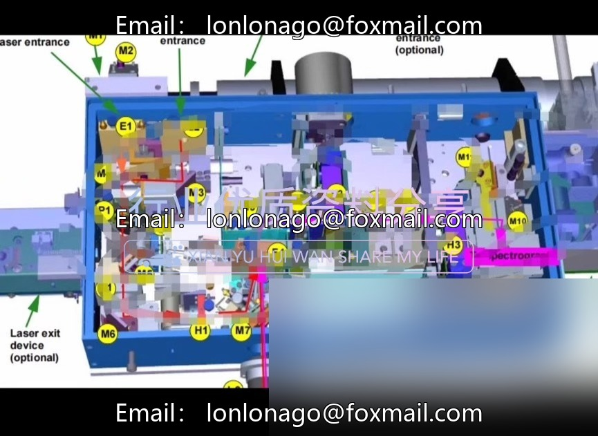
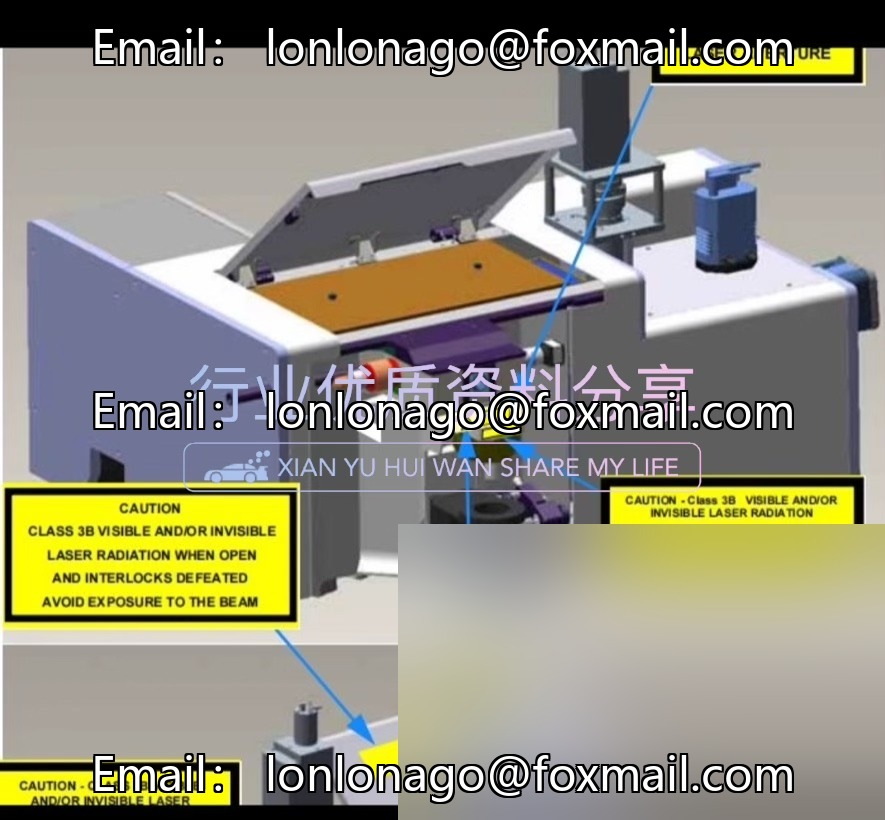
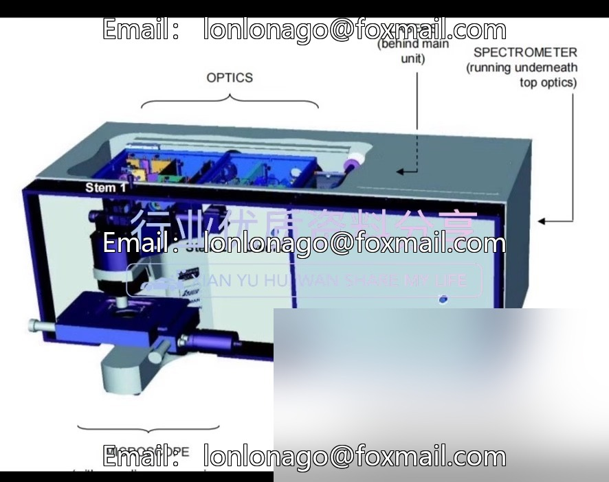
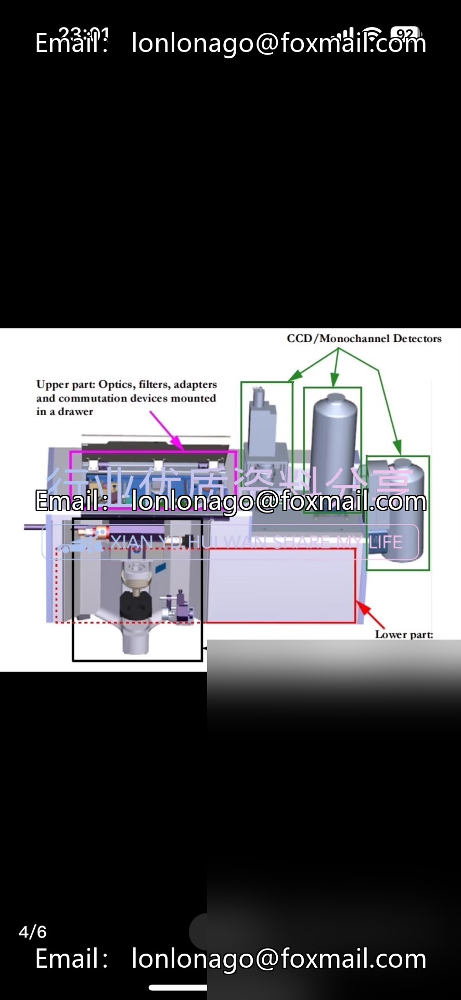
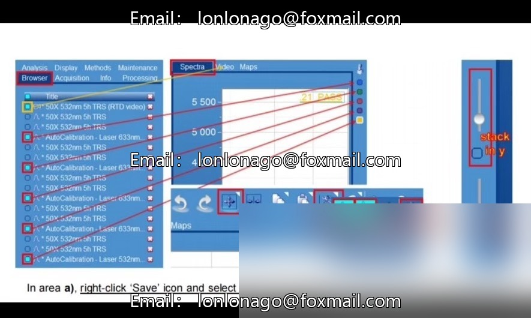
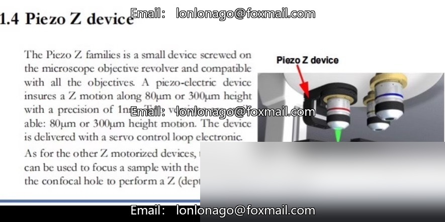

# A set of manuals and materials for a confocal spectrometer: including a user manual, an operation manual, SOP, and technical materials.

## Body

A complete set of specs manual and documentation: including user manual, operation manual SOP, technical materials, and other 14 files! Approaching over 1,000 pages!

Take a photo and send the electronic original directly! The following images contain file portion screenshots. Please confirm before placing an order! Due to the replicability of electronic document materials, So after purchasing, returns cannot be made! Thanks for understanding!

For personal learning and reference use only.

The materials include user manuals, operation manuals (SOP) and technical materials totaling 14 files with nearly thousand pages; the images show instrument information and operation steps.

<!-- AI_ENRICHED -->

## Images

## Payment

Here is a pay link on Stripe ( https://buy.stripe.com/3cs8yP7sY87d0vu9AB ). Please contact me lonlonago@foxmail.com after funding $89, and I will send you a complete data files , thank you!

